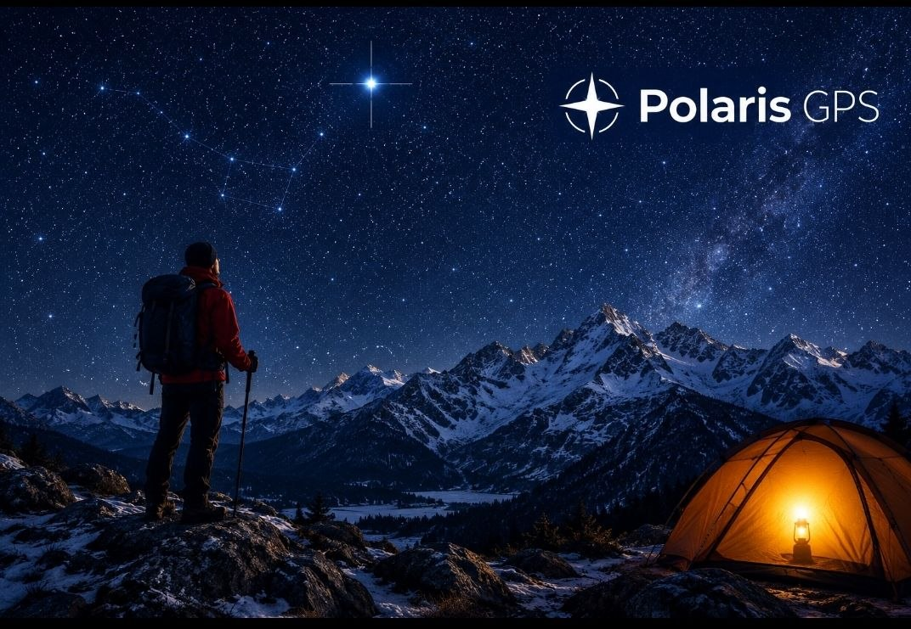
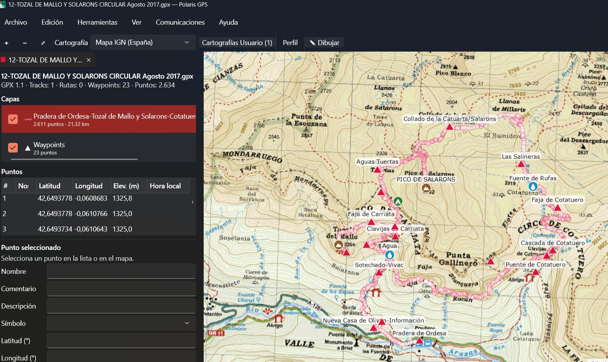
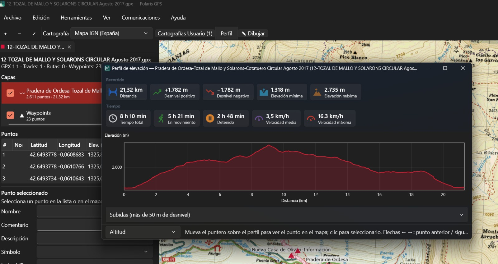

# Polaris GPS

Polaris GPS es un editor de tracks, rutas y waypoints para Windows, pensado para montaña. Abre tus archivos GPX (y los
de Google Earth, Garmin, OziExplorer y CompeGPS/TwoNav), los muestra sobre el mapa del IGN u otras siete cartografías,
y te permite revisarlos, corregirlos, dibujar recorridos nuevos y pasarlos al GPS. Es gratuito.

**Versión actual: 0.8.0** · [Descargar](https://github.com/mendikat/polaris-gps/releases/latest) ·
Guía completa dentro de la aplicación con **F1**

*Un track circular por el Parque Nacional de Ordesa con sus waypoints (cimas, fuentes, refugios…) sobre el mapa del IGN.*

## Qué puedes hacer

- **Ver** tus tracks sobre el mapa del IGN, OpenTopoMap, satélite y otras cartografías, coloreados por altitud,
  pendiente o velocidad, con el perfil de elevación, el desnivel y los tiempos.
- **Corregir** un track grabado: quitar saltos y picos del GPS, suavizar la altitud, tomar las altitudes del MDT del
  IGN, cortar, invertir, unir o simplificar, y regenerar los tiempos (también por el método MIDE).
- **Dibujar** recorridos nuevos con el ratón, siguiendo sendas y pistas de OpenStreetMap, y cerrarlos en circular o en
  ida y vuelta.
- **Editar** punto a punto: mover, insertar, borrar, cambiar nombre, altitud u hora, siempre con deshacer.
- **Añadir waypoints** con símbolo (cima, collado, refugio, fuente…), compatibles con Garmin.
- **Usar tus propios mapas** escaneados o descargados (OziExplorer, CompeGPS/TwoNav, GeoTIFF, ECW…) y tus MDT, sin
  conexión, y **encontrar** los mapas y tracks que tienes guardados de la zona que estás viendo.
- **Ir** a un lugar por su nombre o a unas coordenadas (UTM o grados), y **medir** distancias y rumbos en el mapa.
- **Pasar** el resultado a un GPS Garmin o TwoNav, o traer de él lo que has grabado.
- **Convertir** a GPX archivos KML, KMZ, TCX, PLT, WPT y TRK, uno a uno o por lotes.

Está en español, català, euskara, français y português, y sigue el modo claro u oscuro de Windows.

*Perfil de elevación: distancia, desnivel, altitudes, tiempo total, en movimiento y detenido, y velocidades.*

## Instalar

1. Descarga `PolarisGPS-<versión>-setup.exe` de la página de
   [Releases](https://github.com/mendikat/polaris-gps/releases/latest).
2. Ábrelo. Si Windows SmartScreen avisa, pulsa *Más información › Ejecutar de todas formas* (el instalador aún no
   está firmado).
3. Si falta el runtime de escritorio de .NET 10, el instalador lo instala (va incluido; no hace falta conexión).
4. Elige el idioma, acepta la licencia y la carpeta de destino. Se instala para todos los usuarios y pide permisos de
   administrador.

**Requisitos:** Windows 10 versión 2004 o posterior, o Windows 11, de 64 bits. Internet sólo hace falta para la
cartografía en línea, el MDT del IGN y el seguimiento de caminos; abrir, editar y guardar archivos funciona sin
conexión.

**Actualizar:** instala la versión nueva encima; sustituye a la anterior y conserva tu configuración. Para comprobar
si hay una nueva: *Ayuda › Buscar actualizaciones*.

**Desinstalar:** desde *Configuración de Windows › Aplicaciones*. Tu configuración se conserva.

## Primeros pasos

1. Abre un archivo con *Archivo › Abrir archivo…* (**Ctrl+O**), arrastrándolo sobre la ventana o con doble clic en un
   `.gpx` del Explorador de Windows (los demás formatos, con *Abrir con › Polaris GPS*). Puedes abrir varios: cada uno
   va en su pestaña y todos se ven en el mismo mapa. Los diez últimos están en *Archivo › Archivos recientes*.
2. En el panel **Capas** (izquierda), haz clic en un track para ver su lista de puntos; la casilla lo muestra u oculta.
3. Pulsa **Perfil** para ver el perfil de elevación, el desnivel y los tiempos.
4. Haz clic en un punto (en la lista o en el mapa) para verlo y editarlo en el panel «Punto seleccionado».
5. Si te equivocas, **Ctrl+Z**. Al terminar, **Guardar**.

Un KML, KMZ, TCX, PLT, WPT o TRK se abre como un GPX nuevo sin guardar («ruta.kml» → «ruta.gpx»); el archivo
original no se modifica. **Guardar** pide dónde dejar el GPX.

## Guía por tareas

### Ver y editar puntos

| Quiero… | Cómo |
|---------|------|
| Ver los puntos de un track, ruta o waypoints | Seleccionarlo en **Capas**. Un track en varias partes lista sus segmentos: clic selecciona sus puntos y ✕ elimina ese segmento (con confirmación) |
| Seleccionar puntos | Clic en la lista o en el mapa, cerca del punto. Ctrl o Mayús + clic en la lista para seleccionar varios |
| Mover un punto | Seleccionarlo y arrastrarlo en el mapa, o cambiar latitud y longitud en el detalle y pulsar **Aplicar** (Intro) |
| Cambiar nombre, descripción, elevación u hora de un punto | Panel «Punto seleccionado» › **Aplicar**. **Descartar** (Esc) deshace lo escrito |
| Insertar un punto | **Insert**: punto medio entre el seleccionado y el siguiente. **Ctrl+clic** en el mapa: en ese sitio, tras el seleccionado |
| Eliminar | **Supr** borra los puntos seleccionados. Sin puntos seleccionados, borra el track o ruta (con confirmación) |
| Cambiar el nombre de un track o ruta | Doble clic sobre él en **Capas**, **F2** o clic derecho › **Cambiar nombre**. Intro aplica, Esc cancela; vacío quita el nombre |
| Deshacer o rehacer | **Ctrl+Z** / **Ctrl+Y** (menú *Edición*) |

El **clic derecho en el mapa** ofrece lo que tiene sentido en ese sitio: con un punto de un track seleccionado,
**Insertar punto** (sobre un punto, el punto medio tras él), **Eliminar punto** y las herramientas; sobre un
waypoint, editarlo o eliminarlo; en cualquier sitio, **Añadir waypoint** y buscar mapas o tracks de la zona.

### Waypoints

- **Añadir:** clic derecho en el mapa › **Añadir waypoint…**: nombre, comentario, descripción y **símbolo** (cima,
  collado, aparcamiento, refugio, fuente…). El símbolo se guarda como `sym` de Garmin y se dibuja con su icono.
- **Editar o eliminar:** clic derecho sobre el waypoint, o **Supr** con él seleccionado (siempre con confirmación).
- **Buscar por nombre:** con la capa de waypoints seleccionada, escribe en la casilla sobre la lista.
- Los nombres que se solaparían en el mapa se ocultan hasta que te acercas.

### Dibujar un track o una ruta

1. Pulsa **✎ Dibujar** (o *Edición › Modo dibujo*, **Ctrl+D**). Para empezar uno nuevo en el documento abierto:
   *Edición › Nuevo track* o *Nueva ruta*.
2. Cada clic añade un punto tras el seleccionado. **Esc** termina.
3. Opciones de la barra de dibujo:
   - **Seguir caminos**: une los clics por sendas y pistas de OpenStreetMap (con BRouter), según el tipo de recorrido.
   - **Ajustar a puntos**: toma la posición y la altitud de un punto cercano.
   - **Altitud del MDT**: pone la altitud de tus MDT locales o del IGN a 5 m.
4. La barra de estado muestra la distancia, el desnivel y el tiempo estimado (método MIDE).

Para terminar el recorrido: *Herramientas › Cerrar en circular* (vuelve al inicio, por caminos si están activados) o
*Ida y vuelta* (añade la vuelta por los mismos puntos).

### Corregir y transformar tracks (menú *Herramientas*)

Selecciona el track o ruta en **Capas** antes de usarlas. Las que piden opciones muestran una vista previa, y todas
se deshacen con Ctrl+Z.

| Herramienta | Para qué |
|-------------|----------|
| **Limpiar track…** | Quitar saltos del GPS (por velocidad máxima; necesita horas), picos (el punto se separa y la línea vuelve) y paradas (quedan el primer y el último punto), y suavizar la altitud con un filtro gaussiano (ventana de 100 m por defecto, como mendikat.net) |
| **Ajustar altitudes con el MDT del IGN…** | Sustituir las altitudes del GPS por las del terreno (5 m o 25 m; sólo España, necesita Internet). **Consultar** muestra cuántos puntos cambian y cuántos no tienen dato; **Aplicar** los cambia. El detalle de cada punto dice de dónde sale su altitud |
| **Simplificar track…** | Quitar puntos sobrantes con una tolerancia en metros; muestra cuántos quedan |
| **Regenerar tiempos…** | Poner horas a un track dibujado o corregirlas: fecha, hora y zona horaria de inicio, y velocidad (km/h, m/s, min/km), intervalo fijo o **según la distancia y el desnivel (método MIDE)**: 4 km/h en llano, 400 m/h de subida y 600 m/h de bajada (la velocidad escrita escala las tres). Vista previa en hora local y UTC |
| **Invertir track** | Recorrerlo al revés. Las horas se reflejan: mismo inicio y fin, mismos intervalos |
| **Unir tracks…** | Encadenar tracks de cualquier documento abierto por el extremo más cercano, con un hueco máximo y permitiendo invertir alguno. El resultado se abre en un GPX nuevo; los originales no cambian |
| **Partir en el punto seleccionado** | Dividirlo en dos; el segundo empieza en una copia del punto y lleva « (2)» en el nombre |
| **Eliminar los puntos anteriores / posteriores** | Recortarlo para que empiece o termine en el punto seleccionado |
| **Separar los segmentos en tracks** | Hacer un track de cada segmento |

### Perfil de elevación

Selecciona un track o ruta y pulsa **Perfil** (o *Ver › Perfil de elevación*). Muestra distancia, desnivel positivo y
negativo, altitud mínima y máxima, y tiempo total, en movimiento y detenido.

- Elige la gráfica: altitud, altitud coloreada por pendiente, pendiente (%) o velocidad (km/h).
- Debajo, la lista de subidas de más de 50 m.
- Al pasar el puntero por el perfil se marca el punto en el mapa; clic lo selecciona; ← y → van al punto anterior o
  siguiente.

### El mapa

- **Cartografía:** Mapa IGN (España, por defecto), CyclOSM, OpenTopoMap, OpenStreetMap, Mapa satélite (ESRI), Mapa
  Topográfico (ESRI), Géoportail IGN (France, SCAN 25) y MtbMap. Ninguna pide clave. Se recuerda la elegida.
- **Colorear los tracks:** *Ver › Colorear tracks por* › Altitud, Pendiente o Velocidad, con leyenda en el mapa.
  Ninguno vuelve al color del documento.
- **Regla de escala:** abajo a la derecha, en metros o kilómetros. Se oculta con *Ver › Regla de escala*.
- **Cuadrícula UTM:** se activa con *Ver › Cuadrícula UTM*. Usa el huso del centro del mapa y el datum elegido.
- **Barra de estado:** coordenadas del puntero en UTM (`30T 575700 4760048`) y en grados, minutos y segundos
  (`42º 59' 21,60'' N 2º 04' 17,11'' W`), el datum del archivo y, al detener el puntero, la altitud: la del punto del
  archivo si tiene (`Alt. 1.234 m (archivo)`), la de tus MDT o la del MDT del IGN (`Alt. 846 m (MDT IGN 5 m)`, sólo
  España y con conexión).
- **Medir:** *Ver › Medir distancias* (**Ctrl+M**) o **↔ Medir**: cada clic añade un punto y la barra de estado
  muestra la distancia total y la longitud y el rumbo del último tramo. **Retroceso** quita el último punto; **Esc**
  termina.

### Buscar un lugar o unas coordenadas

*Buscar › Buscar un lugar o coordenadas…* (**Ctrl+F**, también en el clic derecho del mapa) lleva el mapa allí y lo
marca con un círculo rojo:

- **Coordenadas**, en el datum de la configuración: UTM como en la barra de estado (`30T 575700 4760048`), grados
  decimales (`42,9893 -2,0714`) o grados, minutos y segundos (`42º 59' 21'' N 2º 04' 17'' W`). **Intro** va a ellas.
- **Un nombre** (cima, pueblo, refugio…): **Intro** o **Buscar** lo busca en OpenStreetMap (Nominatim, necesita
  Internet), primero cerca de la zona visible; un clic en un resultado va a él.

### Tus propios mapas y MDT

*Archivo › Abrir cartografía…*, o arrastrarlos sobre la ventana, abre mapas escaneados o descargados y modelos
digitales del terreno (MDT). Los ECW servidos por Internet se abren con *Archivo › Abrir cartografía en línea
(ECWP)…*.

- Aparecen en **Cartografías Usuario (n)**, en la barra de herramientas. Ahí puedes arrastrar ≡ (o Ctrl+↑/↓) para
  decidir cuál queda encima, ajustar la opacidad para ver la de debajo, mostrarla u ocultarla con la casilla, ir a
  ella con ⤢ y quitarla con ✕. La cartografía en línea queda siempre al fondo.
- Los mapas se dibujan sobre la cartografía en línea y bajo los tracks.
- Los MDT no se dibujan: dan la altitud bajo el puntero sin conexión, y aparecen en *Ajustar altitudes* y en el
  dibujo.
- No se guardan con el documento ni se recuerdan al cerrar la aplicación.

Los formatos admitidos están en [Cartografía y MDT](#cartografía-y-mdt).

### Buscar mapas y tracks de la zona

Si guardas tus mapas descargados en una carpeta y tus tracks en otra (con las subcarpetas que quieras), Polaris GPS
encuentra los que cubren la zona del mapa que estás viendo:

1. Usa *Buscar › Buscar mapas en la zona visible…* o *Buscar tracks en la zona visible…* (también en el clic
   derecho del mapa).
2. La primera vez te pide la carpeta (se puede cambiar en *Archivo › Configuración… › Carpetas*) y lee todos sus
   archivos para anotar la zona y la fecha de cada uno. Con muchos archivos tarda; **Esc** lo cancela. Las búsquedas
   siguientes sólo leen los archivos nuevos o modificados.
3. Marca los que quieras (los mapas más detallados salen primero) y pulsa **Abrir**. Se abren sin mover el mapa.

### Enviar al GPS o recibir de él

Conecta el GPS por USB. Polaris GPS lo reconoce si aparece en Windows como una unidad de disco:

- **Enviar:** *Comunicaciones › Enviar al GPS…* copia el documento como GPX en `Garmin\GPX` (Garmin; lo carga al
  encenderse) o `TwoNavData\Data` (TwoNav).
- **Recibir:** *Comunicaciones › Recibir del GPS…* lista sus tracks, rutas y waypoints, del más reciente al más
  antiguo; marca los que quieras y se abren.

Los relojes y GPS que se conectan como dispositivo multimedia (MTP), como muchos relojes recientes, no aparecen
como unidad y no se detectan.

### Convertir archivos a GPX

*Archivo › Convertir a GPX…*: elige los KML, KMZ, TCX, PLT, WPT o TRK, la carpeta de destino (por defecto la de cada
archivo) y qué hacer si el GPX ya existe, y pulsa **Convertir**. Al final se muestra un informe por archivo.

### Configuración (*Archivo › Configuración…*)

| Pestaña | Opciones |
|---------|----------|
| **Idioma** | Español (por defecto), català, euskara, français o português. Se aplica al volver a abrir la aplicación, también a la ayuda (F1). El instalador también lo pregunta |
| **Coordenadas** | Datum WGS84 (por defecto) o ED50 para la barra de estado, la lista de puntos, el detalle y la cuadrícula. ED50 sólo en los husos 29 a 31; los archivos se siguen guardando en WGS84 |
| **Carpetas** | Carpeta de mapas y carpeta de tracks para el menú *Buscar* |

El modo claro u oscuro sigue al de Windows (*Configuración de Windows › Personalización › Colores*); el mapa no
cambia.

### Atajos de teclado

| Tecla | Acción |
|-------|--------|
| **Ctrl+O** | Abrir archivo |
| **Ctrl+Z** / **Ctrl+Y** | Deshacer / rehacer |
| **Supr** | Eliminar los puntos, el waypoint o el track seleccionado |
| **Insert** | Insertar un punto tras el seleccionado |
| **Ctrl+clic** en el mapa | Insertar un punto en ese sitio |
| **F2** | Cambiar el nombre del track o ruta |
| **Ctrl+D** | Modo dibujo |
| **Ctrl+M** | Medir distancias; **Retroceso** quita el último punto |
| **Ctrl+F** | Buscar un lugar o coordenadas |
| **Esc** | Terminar de dibujar o de medir, descartar lo escrito o cancelar una carga larga |
| **← →** en el perfil | Punto anterior / siguiente |
| **F1** | Ayuda |
| **Alt** + letra subrayada | Abrir los menús; **Tab** recorre paneles y campos |

### Ayuda

**F1** o *Ayuda › Ayuda de Polaris GPS* abre la guía completa en el navegador, en el idioma de la aplicación. En el
mismo menú: ¡Dona ahora! (PayPal), web de Mendikat, Buscar actualizaciones (no en la versión de Microsoft Store, que
se actualiza desde la Store) y Acerca de.

## Formatos admitidos

### Tracks, rutas y waypoints

| Formato | Lectura | Escritura | Notas |
|---------|:-------:|:---------:|-------|
| **GPX 1.1 y 1.0** | ✓ | ✓ | Se guarda siempre GPX 1.1 válido (un GPX 1.0 se convierte, con aviso), conservando metadatos, campos desconocidos y extensiones. Horas sin zona → UTC, con aviso |
| **KML / KMZ** (Google Earth) | ✓ | — | Puntos → waypoints; líneas → tracks (con horas si las tienen). Polígonos, superposiciones y modelos no existen en GPX: se avisa de cuántos hay. KMZ hasta 256 MB descomprimido |
| **TCX** (Garmin) | ✓ | — | Cada actividad → un track con un segmento por vuelta; pulso y cadencia se conservan (extensión de Garmin que leen Strava y la mayoría de programas). Distancia, velocidad y potencia no se convierten (aviso) |
| **OziExplorer** `.plt`, `.wpt` | ✓ | — | Datum WGS84 o ED50. Altitudes en pies → metros; horas en UTC (aviso) |
| **CompeGPS/TwoNav** `.trk`, `.wpt` | ✓ | — | Datum WGS84 o ED50. Conserva nombre y símbolos; horas pasadas a UTC con la zona del archivo |

El formato se reconoce por el contenido, no por la extensión. OziExplorer y CompeGPS/TwoNav se leen igual que en
mendikat.net; un archivo en otro datum o en coordenadas UTM da un error claro.

### Cartografía y MDT

| Formato | Qué se lee | Limitaciones |
|---------|-----------|--------------|
| OziExplorer `.map` (2.x) | Imagen, datum, proyección, puntos de calibración (grados y minutos o cuadrícula UTM) o, si faltan, las esquinas `MMPLL` | Imagen JPG, PNG, BMP, GIF o TIFF; **OZF2/OZFX3 no** (formato propietario) |
| CompeGPS/TwoNav `.imp` | Imagen (`Bitmap=`), datum y puntos `Pn` en UTM o longitud/latitud (`A`) | Probado con archivos de referencia propios; faltan muestras reales |
| TwoNav `.rmap` | Imagen en teselas JPEG con varios niveles de zoom y la calibración incrustada; se carga el nivel más grande que quepa en 50 megapíxeles. Estructura según el lector de QMapShack (no hay especificación pública) | Sólo teselas JPEG: los RMAP de paleta, 16 bits o MDT se rechazan con un aviso. Faltan muestras reales |
| GeoTIFF `.tif`, `.tiff` y COG `.cog` | Mapas (RGB, paleta o gris; transparencia por NoData o banda alfa) y MDT (una banda numérica, con NoData), en cualquier sistema de coordenadas | Un TIFF sin georreferencia se rechaza. Sin pirámides internas, alejarse mucho en un GeoTIFF enorme es lento; los COG las tienen siempre |
| ECW `.ecw` y ECWP (`ecwp://`, `ecwps://`) | Mapas de cualquier tamaño: se lee sólo la zona visible a la resolución necesaria (un MTN25 de 13 000 × 9 000 píxeles se abre en 0,3 s) | La primera vez hay que aceptar la licencia de uso de ECW. ECWP no se ha probado con un servidor real |
| Imagen con `.tfw`, `.jgw`, `.pgw`, `.gfw`, `.bpw` o `.wld` | Posición y tamaño de píxel del archivo de georreferencia, y sistema de coordenadas del `.prj` con el mismo nombre. Se abre la imagen, no el `.tfw` | Sin `.prj` no se abre |
| SRTM `.hgt` (MDT) | 1″ y 3″, esquina por el nombre (`N42W001`) | Alturas sobre el geoide EGM96, sin convertir |
| ESRI ASCII Grid `.asc` (MDT) | Sistema del `.prj` (WKT, ArcInfo o `EPSG:n`) o, en los MDT del IGN, del nombre (`MDT05-0112-H30-LIDAR`, `PNOA_MDT05_ETRS89_HU30_…`) | Sin `.prj` ni nombre del IGN no se abre. Un MDT05 del IGN (170 MB) tarda unos 3 s |

- `.map`, `.imp` y `.asc` admiten WGS84, ETRS89 y ED50 en los husos 29, 30 y 31, en coordenadas geográficas, UTM o
  Transverse Mercator; cualquier otro sistema se rechaza con un mensaje en vez de colocar el mapa mal. GeoTIFF y ECW
  admiten cualquier sistema que conozca PROJ.
- Las imágenes de más de 50 megapíxeles se cargan a tamaño reducido: se pierde detalle al acercarse mucho.

## Dónde guarda sus datos

| Qué | Dónde |
|-----|-------|
| Configuración (cartografía, idioma, opciones, carpetas) | `%APPDATA%\Polaris GPS\settings.json` |
| Índices de las carpetas de mapas y tracks | `%LOCALAPPDATA%\Polaris GPS\index\maps.json` y `tracks.json` |
| Registro técnico (para informar de errores) | `%LOCALAPPDATA%\Polaris GPS\logs\polarisgps-AAAAMMDD.log` (los 10 últimos días; la carpeta del perfil aparece como `%USERPROFILE%`) |

## Privacidad

Polaris GPS no envía datos personales ni de uso a Mendikat ni a nadie. Sólo se conecta a los servicios que necesita
lo que haces:

- la **cartografía** en línea elegida, para descargar sus mosaicos;
- el **MDT del IGN**, para la altitud bajo el puntero y *Ajustar altitudes*;
- el servidor de rutas **BRouter**, cuando dibujas con *Seguir caminos*;
- la búsqueda **Nominatim** de OpenStreetMap, cuando buscas un lugar por su nombre (recibe el nombre escrito y la zona
  visible del mapa);
- **GitHub**, cuando eliges *Ayuda › Buscar actualizaciones* (no en la versión de Microsoft Store).

Esos proveedores reciben las peticiones como en cualquier navegación web. El registro técnico se queda en tu equipo.

## Licencia

Polaris GPS es un programa **gratuito**: puedes instalarlo y usarlo, también para fines profesionales, pero no
modificarlo ni redistribuirlo sin permiso. Para compartirlo, enlaza a esta página. Se ofrece sin ninguna garantía; las
condiciones completas son las que muestra el instalador. © 2026 Mendikat (Javier Urrutia). Todos los derechos
reservados.

Incluye componentes de terceros con sus propias licencias: GDAL, PROJ, Mapsui, SkiaSharp, NetTopologySuite y otros
(MIT, Apache 2.0, BSD y similares; están en la carpeta `gdal` de la instalación) y el SDK ERDAS ECW/JP2 de Hexagon,
cuya licencia de uso te pide aceptar la aplicación antes de abrir un ECW.

Datos: mosaicos y MDT del IGN España bajo CC BY 4.0 (scne.es); datos OSM bajo ODbL. Servicio de elevaciones: WCS
«Modelos Digitales del Terreno de España» (servicios.idee.es/wcs-inspire/mdt).

## Contacto

Javier Urrutia · [javi@mendikat.net](mailto:javi@mendikat.net) · [www.mendikat.net](https://www.mendikat.net)
